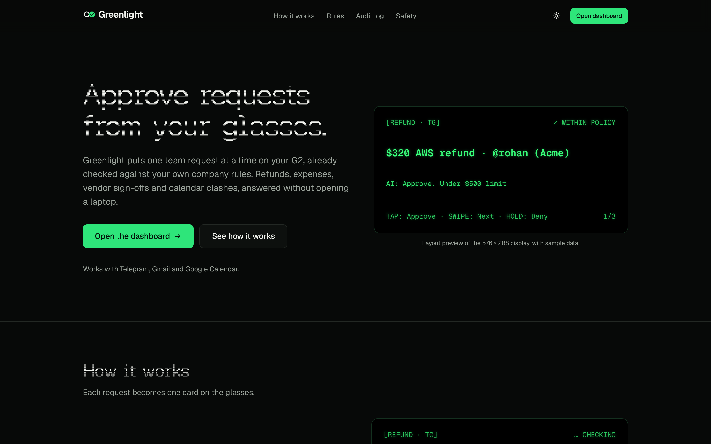

<p align="center"></p>

# Greenlight

**An executive approval terminal for Even Realities G2. Review team requests from Telegram, Gmail and Google Calendar against your own company rules, and sign off in one tap.**

[](https://github.com/Ankur17nith/greenlight/actions/workflows/ci.yml)
[](LICENSE)
[](.nvmrc)
[](apps/web)
[](docs/win-plan.md)

Built for the **Heads Up** hackathon (Even Realities × TVM Ventures × Daos Hub) on DoraHacks.
**Primary track:** 04 · AI Assistants & Work · **Second track:** 01 · Messaging & News · **Special prize:** Best Telegram integration.



> **Honest status:** the website (landing page and dashboard screens) is built and runs today, with sample data. The backend, Policy Guard and the glasses app are being built Nov 25–27. The tables below say exactly what works. See [Status](#status).

**Contents:** [See it in 60 seconds](#see-it-in-60-seconds) · [The problem](#the-problem) · [How it works](#how-it-works) · [On the glasses](#on-the-glasses) · [Policy Guard](#policy-guard) · [Safety model](#safety-model) · [Status](#status) · [Architecture](#architecture) · [Run it](#run-it) · [Docs](#docs) · [What existed before Nov 23](#what-existed-before-nov-23) · [AI tools used](#ai-tools-used) · [Limitations](#limitations) · [Licence](#licence)

## See it in 60 seconds

```sh
git clone https://github.com/Ankur17nith/greenlight && cd greenlight
pnpm install
pnpm dev:web          # http://localhost:3000
```

1. Open the home page and scroll. The G2 display stays pinned and changes as each step passes: request arrives, Policy Guard checks it, you tap (with a 3-second undo), it lands back in Telegram.
2. Press **Open dashboard**: Queue, Connect, Rules, Pair glasses and Audit log. Edit the rules, generate a pairing code, toggle the night and paper themes.
3. Everything on screen is sample data and labelled as such. The live loop (a real Telegram message to a real tap on the glasses) is the Nov 25–27 build; the demo video comes after it.

## The problem

Founders, small-business owners and ops or support leads are the bottleneck for dozens of small decisions a day: a refund, an expense, a vendor invoice, a calendar clash. When they are away from a laptop, their team waits, and the decision happens late or without a record.

## How it works

1. A request arrives from a **Telegram** group, **Gmail** or **Google Calendar**.
2. **Policy Guard** checks it against plain-English rules you wrote once on the dashboard.
3. One card appears on your **G2**: what it is, who sent it, the verdict, a one-line recommendation.
4. **Tap** to approve (with a 3-second undo), **hold** to decline, **swipe** for the next, **double tap** to snooze.
5. The decision writes back where the request came from (a Telegram reply, a Gmail reply, a calendar response) and is added to the audit log.

```
Telegram ─┐
Gmail    ─┼─> apps/api ─> Policy Guard ─> queue ─> apps/g2 (glasses) ─> tap
Calendar ─┘        ^                                         │
                   └──────── write-back + audit log <────────┘
```

## On the glasses

The G2 display is 576 × 288, monochrome green. Greenlight uses four fixed text rows, readable in two seconds, with no scrolling.

```
┌──────────────────────────────────────────────┐
│ [REFUND · TG]                ✓ WITHIN POLICY │
│ $320 AWS refund · @rohan (Acme Corp)         │
│ AI: Approve. Under $500 limit                │
│ [TAP: Approve]  [SWIPE: Next]  [HOLD: Deny]  │
└──────────────────────────────────────────────┘
```

| Gesture | Action |
|---|---|
| Tap | Approve, then a 3-second countdown with tap to undo |
| Swipe | Next or previous card |
| Hold | Decline |
| Double tap | Snooze for one hour |

The gesture map is the target. It is confirmed against the Even Hub SDK on Day 0, with a ring-based fallback if the glasses do not expose hold or double tap ([docs/G2_UI.md](docs/G2_UI.md#verified-gestures)).

## Policy Guard

You write two to four rules in plain English, for example:

1. Flag any refund or expense over $500.
2. Never double-book investor calls.
3. Flag requests from people not in our contact list.

Each request is parsed deterministically for amount and requester, then judged by an AI model against your rules. If the AI times out, errors or returns invalid output, the card still appears, marked **flagged**, so nothing slips through as "safe". The AI only recommends; it never decides. Details: [docs/POLICY_GUARD.md](docs/POLICY_GUARD.md).

## Safety model

| Risk | What Greenlight does |
|---|---|
| A mis-tap approves the wrong thing | Nothing is sent for 3 seconds; a second tap cancels |
| The AI is wrong or is tricked by text in a request | It only recommends; request text is treated as data; invalid output falls back to flagged |
| A double tap sends twice | Every action is idempotent; a card can leave pending only once |
| Keys on the glasses | The glasses hold only a short-lived session token from a 6-digit pairing code |
| Over-broad access | Minimal Google scopes; no funds are ever moved; demos use sandbox accounts |
| "Who approved that?" | Every decision is logged with requester, verdict, decision and time |

More in [SECURITY.md](SECURITY.md) and [docs/safety.md](docs/safety.md).

## Status

| Part | State | How it is checked |
|---|---|---|
| Website: landing page, scroll animation, themes | **Built** | `pnpm typecheck`, `pnpm --filter @greenlight/web build`, browser run (scroll, no-JS and reduced-motion checked) |
| Website: dashboard screens | **Built, sample data** | Same build; no API behind it yet |
| Logo | **Built** | Generated by `apps/web/scripts/build-logo.mjs` |
| `apps/api` backend: Telegram ingest and reply, queue, idempotent act, pairing, rules, audit | **Built, unit-tested with mocks** | `pnpm test`; local run checked with curl. Not yet tried against real Telegram. Gmail and Calendar: not started |
| `packages/policy` Policy Guard: amount parser, verdict, timeout and FLAGGED fallback | **Built, unit-tested with a stubbed model** | `pnpm test`; not yet run against the real model |
| `apps/g2` glasses app: renderer, gesture controller, 3s undo, pairing form | **Built, unit-tested** | `pnpm test`, `pnpm --filter @greenlight/g2 build`. Not yet run in the Even Hub simulator or on glasses |
| Demo video | Script and narration drafted | [video/SCRIPT.md](video/SCRIPT.md) |

Task-by-task progress: [docs/TASKS.md](docs/TASKS.md) and [docs/STATUS.md](docs/STATUS.md).

## Architecture

| Folder | What it is | Stack |
|---|---|---|
| `apps/web` | Landing page and dashboard (frontend) | Next.js 16, React, Tailwind 4, Geist fonts, night and paper themes |
| `apps/g2` | The glasses app (frontend) | TypeScript, Vite, Even Hub SDK |
| `apps/api` | Backend: ingest, queue, write-backs, audit, pairing | Node, TypeScript, SQLite |
| `packages/policy` | Policy Guard | TypeScript, pure function |
| `packages/shared` | Types, schemas, fixtures | TypeScript, zod |
| `docs/`, `video/`, `.design/` | Docs, demo script and production, design system | Markdown |

Google sign-in cannot run inside the glasses' WebView, so accounts are connected on the website and the glasses link with a 6-digit code. Full design: [docs/architecture.md](docs/architecture.md) and [plan.md](plan.md).

## Run it

Needs Node 22 and pnpm.

```sh
pnpm install
pnpm dev:web                          # website on http://localhost:3000
pnpm dev:api                          # backend on http://localhost:3001 (see .env.example)
pnpm dev:g2                           # glasses app on http://localhost:5173
pnpm test                             # unit tests for every package
pnpm typecheck                        # type checks every package
pnpm --filter @greenlight/web build   # production build of the website
```

The API and glasses app commands are added here as each part lands. Account setup (Telegram, Google, Even Hub, ElevenLabs) is in [docs/SETUP.md](docs/SETUP.md). Copy `.env.example` to `.env`; never commit real values.

## Docs

| Doc | What it covers |
|---|---|
| [plan.md](plan.md) | Scope, architecture, three-day schedule, risks |
| [docs/README.md](docs/README.md) | Index of every doc |
| [docs/TASKS.md](docs/TASKS.md) | Task tracker with Do and Done-when lines |
| [docs/win-plan.md](docs/win-plan.md) | Judging criteria and how we score on each |
| [docs/API.md](docs/API.md) · [docs/POLICY_GUARD.md](docs/POLICY_GUARD.md) · [docs/G2_UI.md](docs/G2_UI.md) | Routes, rules engine, glasses interface |
| [docs/DEMO_RUNBOOK.md](docs/DEMO_RUNBOOK.md) · [video/](video/PRODUCTION.md) | Running the demo, making the video |
| [.design/](.design/DESIGN.md) | Brief, taste, design system |
| [ROADMAP.md](ROADMAP.md) · [CHANGELOG.md](CHANGELOG.md) · [CONTRIBUTING.md](CONTRIBUTING.md) | Project history and process |

## What existed before Nov 23

Nothing. Greenlight was started on Nov 24, during the hackathon. Its documentation structure was inspired by the open-source repos [LifeLine](https://github.com/Prashant-thakur77/LifeLine) and [Beacon](https://github.com/Prashant-thakur77/Beacon), the website's look by [Debrief](https://github.com/Prashant-thakur77/Debrief), and the teaser-video workflow by [brag](https://github.com/latent-spaces/brag). No code was copied from any of them. Open-source libraries (Next.js, React, Tailwind, Radix Slot, lucide, next-themes, Geist fonts under the SIL Open Font License) and the Even Hub SDK are used as dependencies.

## AI tools used

- **Claude Code** helped write the code, docs and design, and is credited as co-author on commits.
- **Claude** (a small model) is planned for Policy Guard's rule checks, behind a deterministic fallback.
- **ElevenLabs** is planned for the demo video's voice-over only; the app itself never calls it.

## Limitations

- The glasses app and backend are not built yet; this README describes the plan wherever the status table says so.
- The gesture map is unconfirmed until the Day 0 spike fills in the table in [docs/G2_UI.md](docs/G2_UI.md#verified-gestures).
- Google OAuth runs in Testing mode with named test users, which is enough for a demo, not for general release.
- Greenlight never moves funds. Demos use sandbox accounts and test data only.

## Licence

MIT. See [LICENSE](LICENSE).
